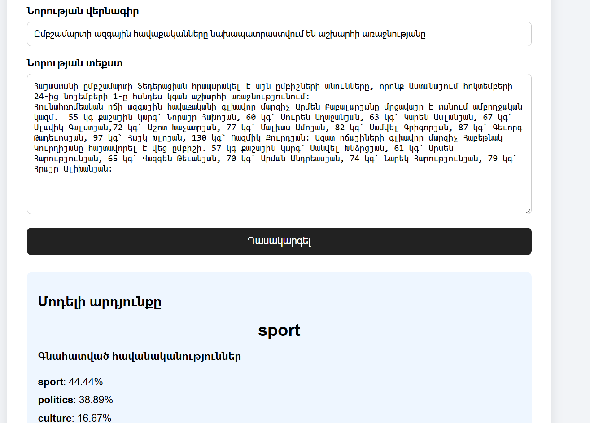

Aravot News Classifier 🇦🇲

A Python and Machine Learning project that classifies Armenian news articles into three categories: Politics, Culture, and Sport. The project collects article data from Aravot.am, processes news text with TF-IDF, trains a Logistic Regression classifier, and provides a simple Armenian-language Flask web interface for predictions.

Highlights

Scrapes article titles, body text, category labels, URLs, and dates with Selenium.

Saves collected data to a CSV file.

Cleans records and removes duplicate articles before model training.

Uses TF-IDF to convert article text into numerical features.

Trains a Logistic Regression text-classification model.

Evaluates the model on a held-out test set.

Lets a user enter a headline and article text in a web form.

Shows the predicted category and estimated probabilities for all categories.

Categories

politics

culture

sport

Tech stack

Python

pandas

Selenium

scikit-learn

TF-IDF

Logistic Regression

Flask

HTML / CSS

Project structure

Selenium/
├── api.py
├── main.py
├── aravot_news.csv
├── requirements.txt
├── .gitignore
├── README.md
├── index.html
└── Untitled.ipynb

api.py currently contains the Flask application and the HTML template used by the interface. The scraper is in main.py.

Dataset

The dataset used in the development run contained 189 articles:

Category

Articles

Politics

100

Sport

45

Culture

44

Total

189

The counts can change when the scraper is run again. The dataset is small, and the categories are imbalanced, so results should be treated as preliminary.

Model and evaluation

The classifier combines the article headline and body text, transforms the combined text with TfidfVectorizer, and trains LogisticRegression(max_iter=1000).

Best recorded Notebook result

In the Jupyter Notebook run shown during development, the model achieved:

Accuracy: 81.48%

Test set: 27 articles

Per-category metrics from that run:

Category

Precision

Recall

F1-score

Support

Culture

0.88

0.78

0.82

9

Politics

0.70

0.78

0.74

9

Sport

0.89

0.89

0.89

9

Overall accuracy

0.81

27

Macro average

0.82

0.81

0.82

27

Weighted average

0.82

0.81

0.82

27

This is the best result recorded so far in the Notebook. It is a preliminary score on a small test set, not a guarantee of performance on future news articles.

Important evaluation note

The API's evaluation run previously reported 71.05% accuracy on 38 test articles. That run used a different dataset split, so its score is not directly comparable to the Notebook's 81.48%. For a fair comparison, keep the same cleaned dataset, train/test split, random state, and preprocessing steps when comparing models.

Installation

Use Python 3.10 or newer as a starting point. From the project directory, install the dependencies:

pip install -r requirements.txt

Run the web app

Ensure aravot_news.csv is located in the same directory as api.py, then run:

python api.py

Open the local address in your browser:

http://127.0.0.1:5000

Enter a news headline and article text, then click Դասակարգել. The page displays the predicted category and the model's estimated probabilities.

The model is trained when the application starts, so startup may take a little time.

Collect news data

The Selenium scraper is in main.py. It is configured to target up to 100 articles per category.

python main.py

The scraper writes aravot_news.csv and logs its progress to scraper.log.

Before collecting or publishing article text, review Aravot.am's terms of use and robots.txt, make requests responsibly, and verify that redistribution of the collected content is permitted.

Limitations and future work

The dataset is small and imbalanced.

The current test sets contain relatively few examples, so a small number of predictions can significantly change the metrics.

The model may not generalize well to all Armenian news articles.

predict_proba() values are model-estimated probabilities and are not necessarily calibrated confidence values.

Future improvements could include collecting more labeled articles, evaluating with stratified cross-validation, reviewing misclassified examples, tuning TF-IDF settings, and comparing Logistic Regression with Linear SVM.

For public deployment, run Flask behind a production WSGI server and disable debug mode.

Data and responsible use

This project is intended for educational and experimental use. Before publishing aravot_news.csv or redistributing scraped article text, verify that you have permission and comply with the website's terms and applicable copyright rules. If permission is uncertain, publish the code and instructions for generating the dataset without including the scraped article text.

License

No license has been selected yet. Add a license only when you have decided how others may use, modify, and distribute this project.
## Application Preview

